# AllNote

A self-hosted web note app that combines the best of **Obsidian** (Markdown, `[[wiki links]]`, backlinks, graph view, tags, callouts, embeds) and **Evernote** (notebooks, pinned notes, sharing, publishing, version history), with administrator-managed accounts, Google single sign-on, two-factor authentication, license keys, live collaboration and PIN-protected publishing.

Current version: **1.1.0** (shown on the landing page, the sign-in page and inside the app).

## Contents

- [Features](#features)
- [System structure](#system-structure)
- [Component communication](#component-communication)
- [Feature workflows](#feature-workflows)
- [Quick start (local development)](#quick-start-local-development)
- [Deploy with Docker Compose](#deploy-with-docker-compose-behind-a-tunnel)
- [Administration](#administration)
- [Configuration reference](#configuration-reference)
- [Testing](#testing) and [test summary](#test-summary)
- [Keyboard shortcuts](#keyboard-shortcuts), [backup](#backup), [project structure](#project-structure)

## Features

| Area | What you get |
| --- | --- |
| Writing | **WYSIWYG live preview**: one continuous document that looks exactly like the final note while you edit it (no Markdown symbols, no block-by-block raw text). Markdown shortcuts format as you type (`# `, `- `, `1. `, `[ ] `, `> `, `**bold**`, `==highlight==`, `---`, ```` ``` ````), `[[` autocomplete inserts note links, checkboxes, tables, callouts with a type picker, embeds and code blocks are edited in place. Source, split and reading modes are still available, and notes are stored as plain Markdown |
| Linking | `[[Note]]`, `[[Note\|alias]]`, `[[Note#Heading]]`, `![[Note]]` embeds, `[[` autocomplete, click a missing link to create the note, backlinks, outgoing links, outline, interactive graph view |
| Organising | Nested folders (`Work/Projects`), **drag and drop** in the sidebar (reorder notes, move notes and folders in and out of folders, reorder folders, drop on Pinned or Trash; mouse or press-and-hold on touch), `#tags` (nested `#work/alpha`), pinned notes, trash and restore, daily notes, quick switcher (`Ctrl+K`), full-text search with `tag:` and `notebook:` filters |
| Collaboration | Share a note by email as *Can edit* / *Can view*, live updates over Server-Sent Events, presence avatars, automatic 3-way merge of concurrent edits, version history with restore |
| Publishing | One-click public page at `/p/<link>`, custom link, optional **PIN** (hashed, rate limited, re-locks when the PIN changes) |
| Accounts | First user becomes the **administrator**; new sign-ups need **admin approval**; per-user **expiration dates**; **license keys** with custom durations to reactivate expired accounts |
| Administration | Admin console: approve, suspend, add and remove users, reset passwords and 2FA, set or renew expiration, generate and revoke license keys, configure Google SSO, sign-up and the landing page |
| Security | Email + password (scrypt), **Google SSO** (OpenID Connect, configured in the UI), **TOTP 2FA** with QR code and recovery codes, HttpOnly SameSite cookies, CSRF origin check, strict CSP, rate limiting for login, 2FA, PIN and license keys |
| Experience | Landing page (can be turned off), **onboarding tour** on first sign-in (replay any time from Help), **light and dark mode** everywhere, professional icons (no emoji) including inside every input field, version display, automatic reload after a deploy |
| Data | Import Markdown files, export a note as `.md`, export everything as JSON |

The server is a thin data store (SQLite via Node's built-in `node:sqlite`) plus authentication and administration. Markdown rendering and sanitising, link and tag indexing, search, graph layout, conflict merging and import/export all run in the browser.

## System structure

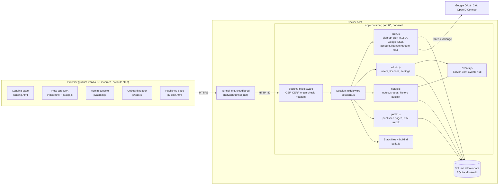

| Layer | Files | Responsibility |
| --- | --- | --- |
| Front-end | `public/js/app.js`, `admin.js`, `tour.js`, `common.js`, `markdown.js`, `merge.js`, `graph.js`, `ui.js`, `icons.js` | UI, editing, sync, merge, admin console, tour, field icons, theme, update detection |
| HTTP | `server/index.js` | Security headers, CSRF check, routing, landing vs. app, no-store HTML, vendor files |
| Auth and accounts | `server/auth.js`, `sessions.js`, `users.js`, `security.js` | Sessions, password hashing, TOTP, Google SSO, account status (`active`, `pending`, `expired`) |
| Administration | `server/admin.js`, `settings.js` | Users, approvals, expiration, license keys, sign-in and site settings |
| Data | `server/db.js` | SQLite schema and backward-compatible migrations |
| Realtime | `server/events.js` | SSE fan-out of note changes, presence and account changes |

## Component communication

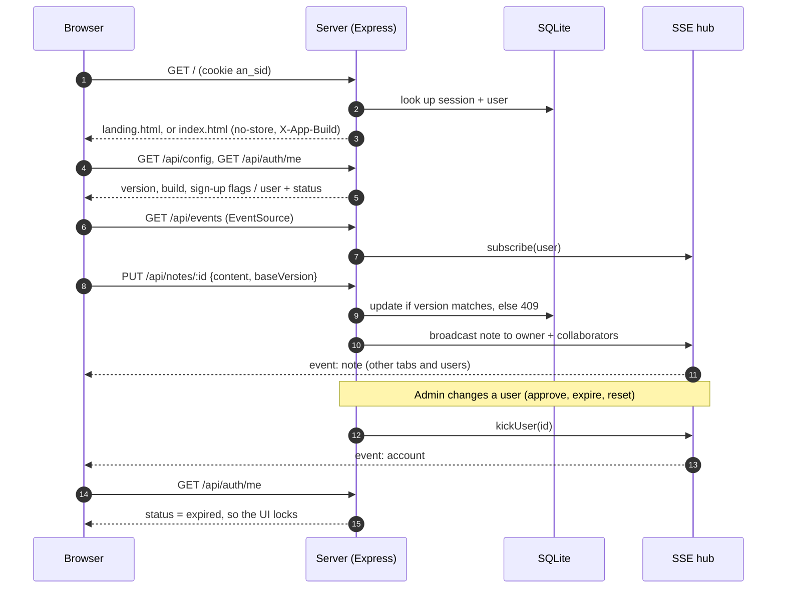

All requests are JSON over HTTPS. State-changing requests must come from the same origin. Live updates use Server-Sent Events (`/api/events`), which reconnect automatically and trigger a build check after a deploy.

## Feature workflows

### First deployment and admin setup

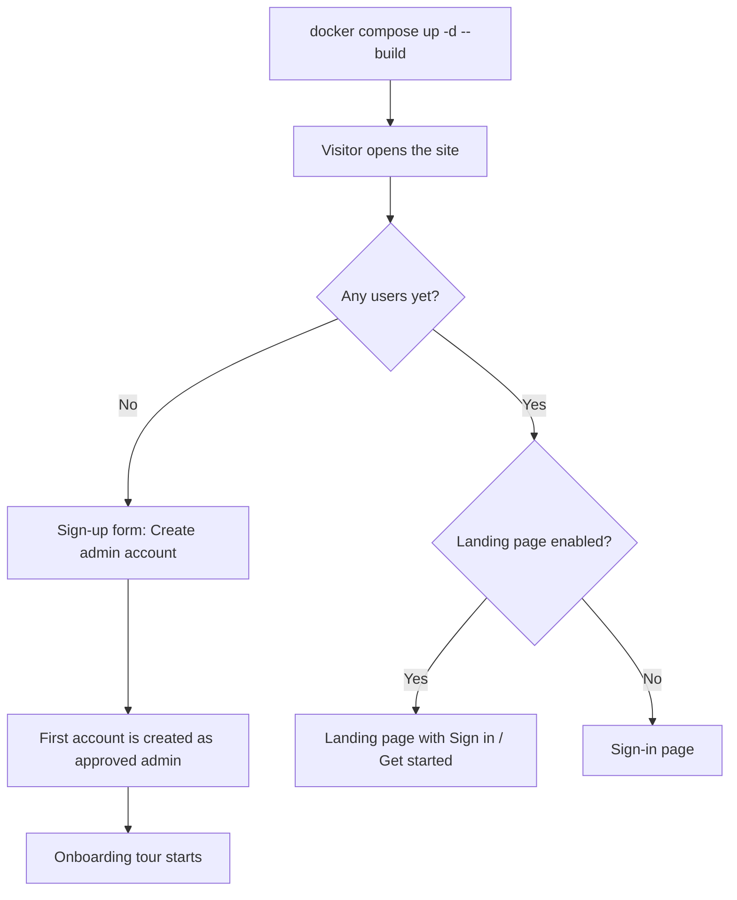

### Registration and admin approval

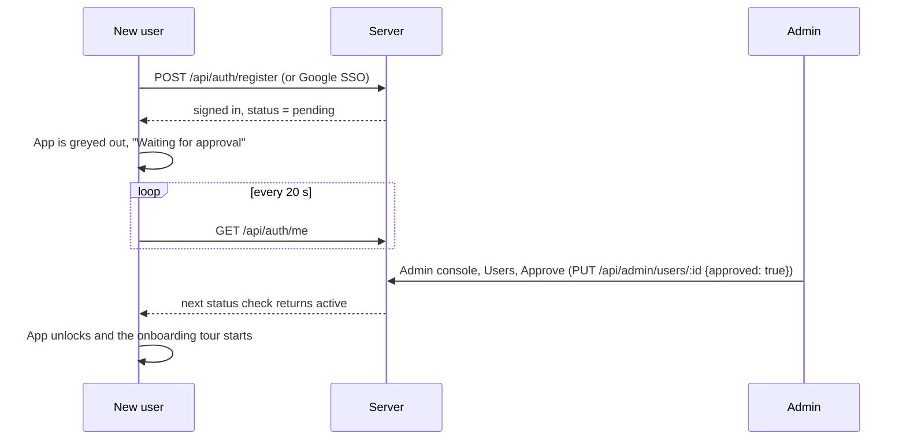

Approval can be turned off in *Admin console, Sign-in*. Users added by the admin are approved immediately.

### Sign in with password and two-factor authentication

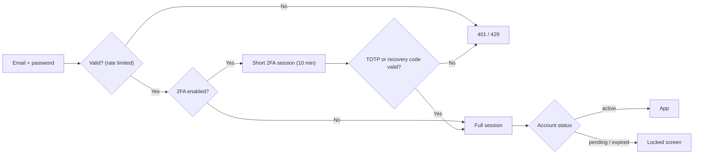

### Google single sign-on

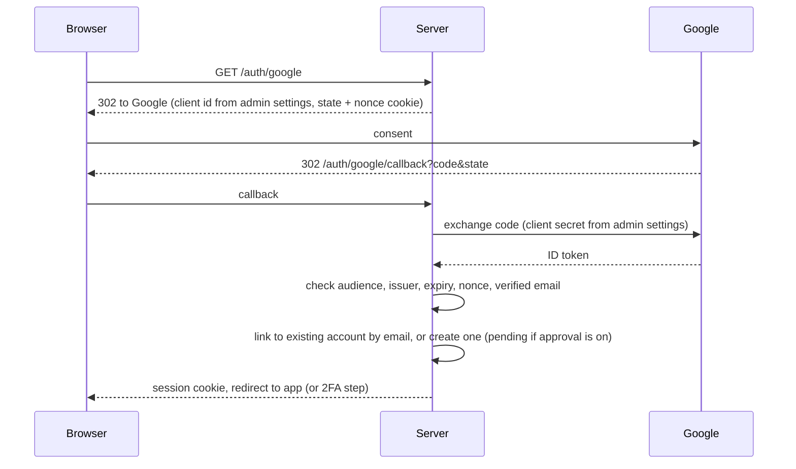

### Account expiration and license keys

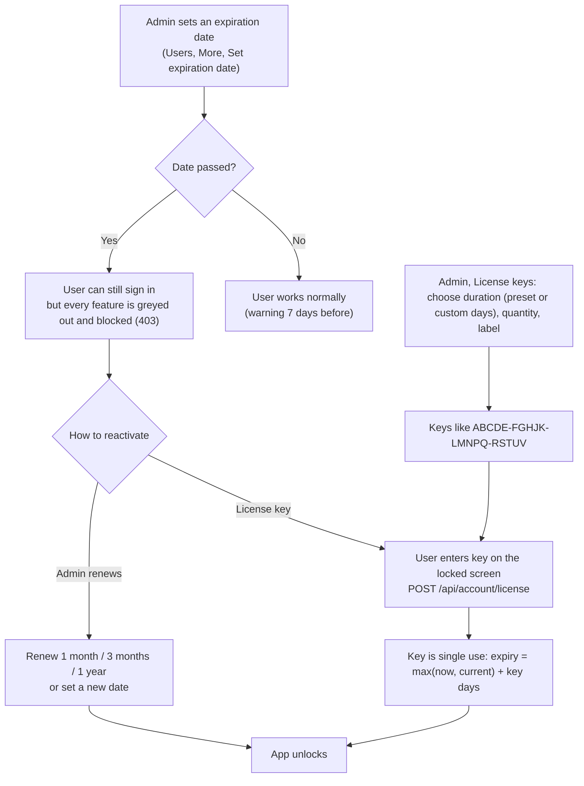

### Admin user management

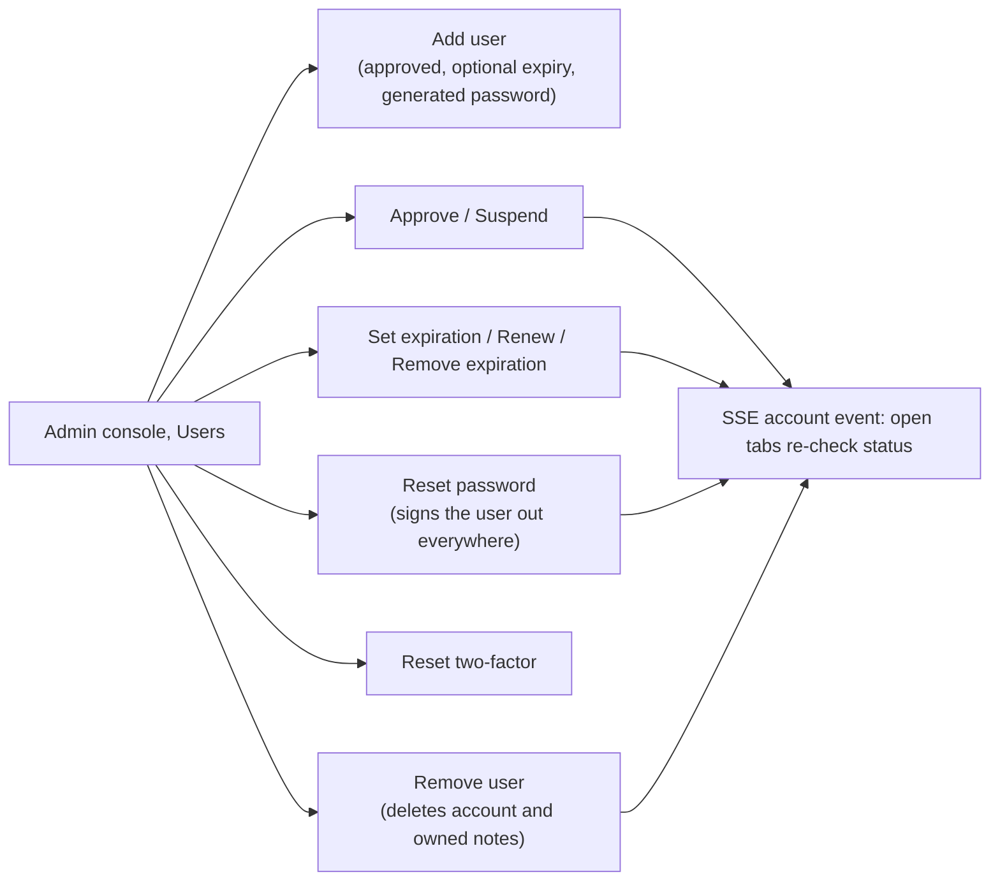

### Editing, sync and conflict merge

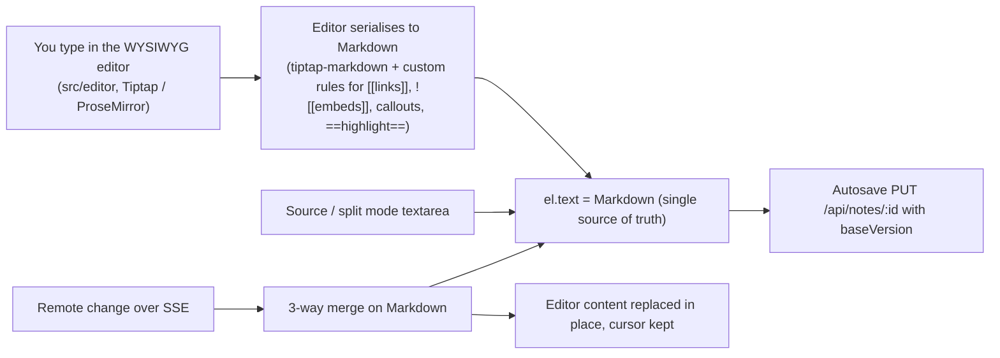

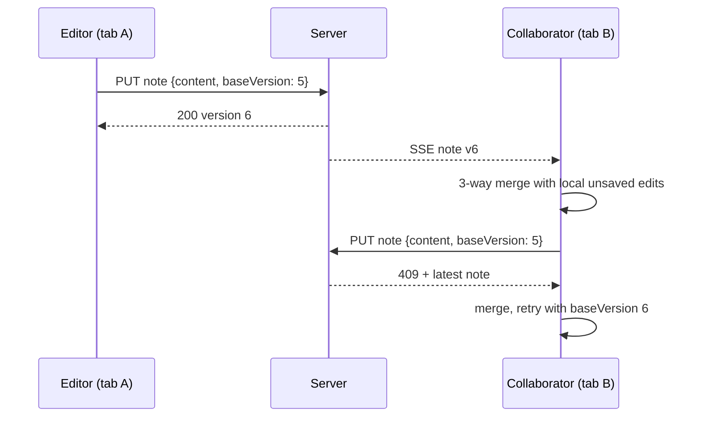

### Sharing and live collaboration

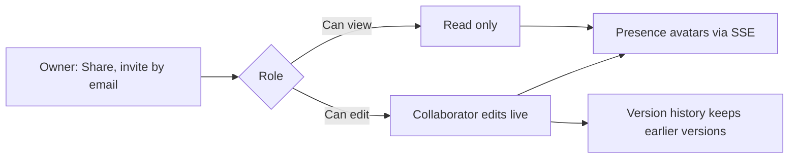

### Drag and drop in the file tree

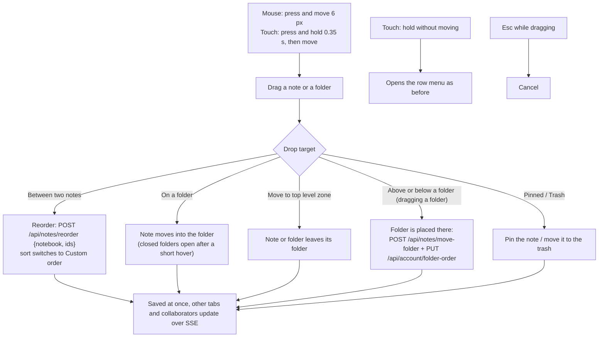

Only the owner can arrange notes. Arranging never creates a new version of a note.

### Publishing with a PIN

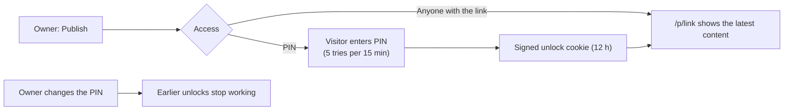

### Onboarding tour

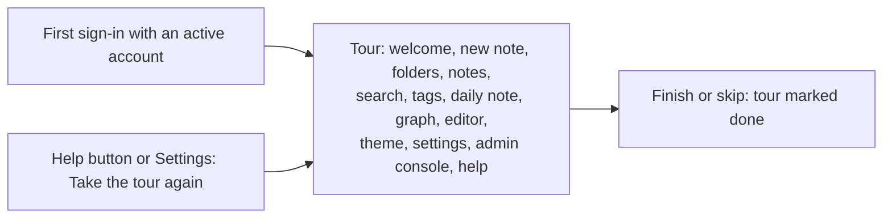

### Deploy, update and cache refresh

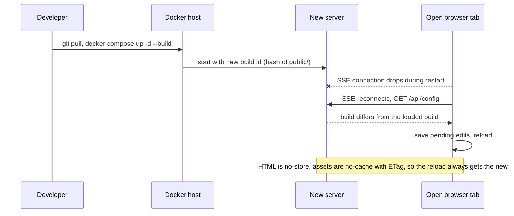

## Quick start (local development)

Requires Node.js **22.13+** (Node 24 recommended).

```bash
npm install
npm run dev           # http://localhost:3000 (auto-restarts on server changes)
npm test              # all test suites
npm run test:report   # tests + dependency audit, saves test/reports/latest.md and updates this README
npm run build:editor  # rebuild public/vendor/editor.js after changing src/editor (the bundle is committed)
```

Data is stored in `./data` by default (`DATA_DIR`). Outside Docker the app listens on port 3000 unless `PORT` is set.

## Deploy with Docker Compose (behind a tunnel)

- The image is **built locally** from this folder; nothing is pulled from Docker Hub except the `node` base image.
- The app listens on **port 80 inside the container** as a non-root user. **No ports are published** on the host.
- The container joins the Docker network **`tunnel_net`** with the alias `allnote`. Point your tunnel (for example `cloudflared` on the same network) at **`http://allnote:80`**.
- There is no auto-updater: you update by pulling and rebuilding.

```bash
git clone https://github.com/<you>/allnote.git
cd allnote
cp .env.example .env               # optional, defaults work
docker network create tunnel_net   # only if it doesn't exist yet
docker compose up -d --build
```

Update after a `git pull` with `docker compose up -d --build`. Notes live in the `allnote-data` volume, and open browser tabs reload themselves onto the new version.

> Upgrading from 1.0: the container now listens on port 80 instead of 3000. Point the tunnel at `http://allnote:80`, or set `PORT=3000` in `.env` to keep the old port. The database migrates automatically (see [backward compatibility](#testing)).

## Administration

### First run: create the admin

On a fresh install the site opens the sign-up form: **the first account becomes the administrator**. Every account created after that is a normal user. On an existing install without an admin, the oldest account is promoted automatically.

### Admin console

Open it with the shield button in the sidebar footer (a red dot means users are waiting for approval) or from *Settings, Open admin console*.

| Tab | What you can do |
| --- | --- |
| Users | Filter, approve or suspend, add users (with generated password and optional expiry), set or remove expiration dates, renew for 1 month, 3 months or 1 year, reset passwords (signs the user out everywhere), reset two-factor, remove users |
| License keys | Generate 1 to 100 keys for a preset or custom number of days with an optional label; copy or download them; see who redeemed which key; revoke unused keys |
| Sign-in | Allow or block new sign-ups, require approval for new accounts, configure Google single sign-on |
| Site | Turn the landing page on or off, preview it at `/welcome`, see the version and build |

### Account states

| State | Sign in | Use the app | How it changes |
| --- | --- | --- | --- |
| Active | Yes | Yes | |
| Pending approval | Yes | No, the app is greyed out with a "Waiting for approval" screen | Admin approves |
| Expired | Yes | No, the app is greyed out with a license key form | User redeems a license key, or admin renews or sets a new date |

Administrators are always active. Locked accounts can only check their status, redeem a license key and sign out; every other API call returns `403` with `code: account_pending` or `account_expired`.

### Google single sign-on

Configured in the admin console, with no environment variables or restart needed.

1. [Google Cloud Console](https://console.cloud.google.com/), *APIs & Services, OAuth consent screen*: configure it (External or Internal).
2. *Credentials, Create credentials, OAuth client ID*, type **Web application**.
3. **Authorized redirect URI:** copy it from *Admin console, Sign-in* (for example `https://notes.example.com/auth/google/callback`).
4. Paste the **Client ID** and **Client secret** into *Admin console, Sign-in* and save.

The *Continue with Google* button appears once both values are saved. The secret is stored in the database and never sent back to the browser (leave the field empty to keep it). Accounts are matched by verified email. If 2FA is enabled, Google sign-in still asks for the code. The redirect URI is derived from `PUBLIC_URL`, or from the request (`Host` and `X-Forwarded-Proto` from the tunnel) if that is empty.

### Two-factor authentication

Every user can turn it on: *Settings, Two-factor authentication, Enable 2FA*, scan the QR code with any TOTP app (Google or Microsoft Authenticator, 1Password, Authy) and enter the code. You get 8 one-time recovery codes. Enabling 2FA or changing the password signs out other sessions. An admin can reset 2FA for a user who lost their phone.

### Publishing with a PIN

Open a note, choose **Publish**, then copy the link (`/p/<link>`, customisable). Optionally set a 4 to 12 character **PIN**: visitors must enter it before any content is sent, 5 wrong attempts per 15 minutes are blocked, and changing the PIN invalidates previous unlocks.

### Landing page

Anonymous visitors see a landing page at `/` (on by default). Turn it off in *Admin console, Site* to send visitors straight to sign-in. `/login` and `/signup` always open the sign-in and sign-up forms.

## Configuration reference

| Variable | Default | Description |
| --- | --- | --- |
| `APP_NAME` | `AllNote` | Name shown in the UI and authenticator apps |
| `PORT` | `80` in Docker, `3000` otherwise | Port the app listens on inside the container |
| `PUBLIC_URL` | *(empty = from request)* | External URL, for example `https://notes.example.com`; used for the Google redirect URI |
| `SESSION_SECRET` | auto-generated | Signs PIN-unlock cookies (persisted in the data volume if empty) |
| `SESSION_DAYS` | `30` | Session lifetime |
| `COOKIE_SECURE` | auto | Secure cookies; defaults to HTTPS of `PUBLIC_URL` or the request |
| `ALLOW_SIGNUP` | `true` | Initial value; the admin can change it in the admin console |
| `ALLOWED_EMAILS` | *(empty = anyone)* | For example `alice@x.com,@mycompany.com` |
| `TRUST_PROXY` | private ranges | Express trust-proxy setting (the tunnel on `tunnel_net` is a private range) |

Google SSO, approval, sign-up and landing page settings are stored in the database and managed in the admin console.

## Testing

```bash
npm test              # run all suites
npm run test:report   # run all suites + npm audit, save the report and refresh the summary below
```

Run `npm run test:report` whenever a feature is added or removed. It writes:

- `test/reports/latest.md`: the full report (per-test results, security section, environment, dependency audit)
- `test/reports/latest.txt`: raw output
- `test/reports/history.md`: one line per run
- the [test summary](#test-summary) below

| Suite | File | Covers |
| --- | --- | --- |
| Core features | `test/api.test.js` | Registration, sign-in, 2FA and recovery codes, notes, optimistic versioning, sharing roles, history, publishing with PIN, drag and drop arrangement (reorder, move notes and folders, folder order, owner only), Google SSO settings |
| Administration | `test/admin.test.js` | First admin, approval flow, sign-up and approval settings, expiration and renewal, license keys (generate, redeem, stack, single use, revoke), add, reset and remove users, tour flag, landing page toggle, version and cache headers |
| Security | `test/security.test.js` | Every admin endpoint requires an admin, privilege escalation attempts, admin self-lockout protection, locked accounts blocked from every feature and the event stream, brute-force limits (login, license keys), CSRF, security headers and cookie flags, no secret leakage, input validation and injection, path traversal |
| Backward compatibility | `test/migration.test.js` | A v1.0 database upgrades in place: accounts, passwords, sessions and notes are kept, the oldest user becomes admin, existing users stay approved |
| UI guarantees | `test/ui.test.js` | No emoji in the front-end, every referenced icon exists, light and dark mode on every page, version on the sign-in page, the app and the landing page, automatic field icons |
| WYSIWYG editor | `test/editor.test.js` | Markdown round trip through the editor (headings, emphasis, highlight, line breaks, wiki links, embeds, tags, lists, tasks incl. empty ones, callouts, tables, code, links, images, inline HTML), wiki links and callouts render without Markdown syntax |

### Test summary

<!-- test-summary:start -->
**Last run:** 2026-11-26 17:27 UTC, version 1.1.0: **PASSED**, 58/58 tests passed. Dependency audit: no known vulnerabilities in production dependencies.

| Suite | Tests | Passed | Failed | Time |
| --- | ---: | ---: | ---: | ---: |
| Administration, approval, expiration, licenses, landing page, tour, versioning | 7 | 7 | 0 | 3.5 s |
| Core features (auth, 2FA, notes, sharing, publishing, Google SSO) | 6 | 6 | 0 | 4.8 s |
| WYSIWYG editor (Markdown round trip, rendering without syntax) | 29 | 29 | 0 | 4.1 s |
| Backward compatibility (v1.0 database upgrade) | 1 | 1 | 0 | 1.6 s |
| Security (access control, locked accounts, brute force, CSRF, headers, secrets, validation) | 11 | 11 | 0 | 4.9 s |
| UI guarantees (no emoji, icons, light/dark mode, version display) | 4 | 4 | 0 | 0.2 s |
| **Total** | **58** | **58** | **0** | |

Full report: [test/reports/latest.md](test/reports/latest.md)
<!-- test-summary:end -->

## Keyboard shortcuts

| Keys | Action |
| --- | --- |
| `Ctrl/Cmd + K` | Quick switcher (find or create a note) |
| `Alt + N` | New note |
| `Ctrl/Cmd + E` | Toggle live preview / reading view |
| `Ctrl/Cmd + S` | Save now |
| `Ctrl/Cmd + B` / `I` | Bold / italic |
| `Ctrl/Cmd + Shift + H` | Highlight (live preview) |
| `Ctrl/Cmd + Enter` | Toggle checklist on line |
| `Ctrl/Cmd + Z` / `Ctrl/Cmd + Shift + Z` | Undo / redo |
| `Ctrl/Cmd + click` | Open a web link or show all notes with a tag (live preview) |
| `Tab` / `Shift+Tab` | Indent / outdent |
| `[[` | Link autocomplete |
| `Esc` while dragging | Cancel the drag |

## Backup

```bash
docker run --rm -v allnote_allnote-data:/data -v "$PWD":/backup alpine tar czf /backup/allnote-backup.tgz -C /data .
```

## Project structure

```
server/
  index.js        HTTP server, security headers, routing, landing vs. app
  auth.js         Sign up, sign in, 2FA, Google SSO, account, license redeem, tour
  admin.js        Admin API: users, approvals, expiration, license keys, settings
  sessions.js     Sessions, account status, requireAuth / requireActive / requireAdmin
  users.js        User creation (first user becomes admin)
  settings.js     Settings stored in the database
  build.js        Build id used for cache busting and auto-reload
  db.js           SQLite schema and migrations
  notes.js        Notes, sharing, history, publishing, presence
  public.js       Published pages and PIN unlock
  events.js       Server-Sent Events hub
public/
  index.html      App + sign-in page
  landing.html    Landing page
  publish.html    Public page for published notes
  js/app.js       UI, sync, collaboration, locked screen, help
  js/admin.js     Admin console
  js/treedrag.js  Drag and drop for the sidebar tree (mouse and touch)
  js/tour.js      Onboarding tour
  js/common.js    Theme toggle, field icons, version, update detection
  js/markdown.js  Markdown, wiki links, embeds, tags, callouts (marked + DOMPurify)
  vendor/editor.js Built WYSIWYG editor bundle (from src/editor, committed)
  js/merge.js     3-way merge (diff-match-patch)
  js/graph.js     Force-directed graph on canvas
scripts/
  test-report.js  Runs tests + npm audit and saves the report
  build-editor.js Bundles src/editor into public/vendor/editor.js (esbuild)
src/editor/       WYSIWYG editor source (Tiptap + Markdown rules for the app's syntax)
test/             node:test suites and reports
```
